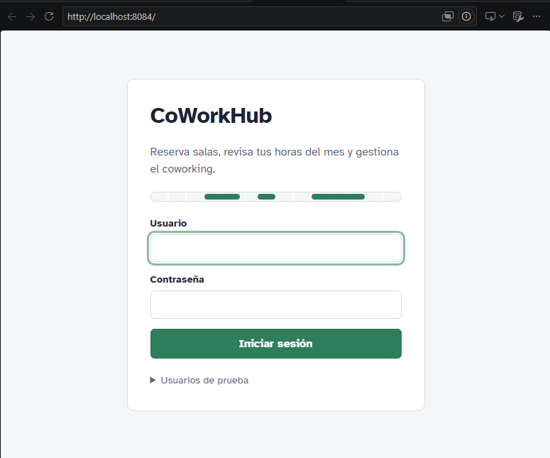
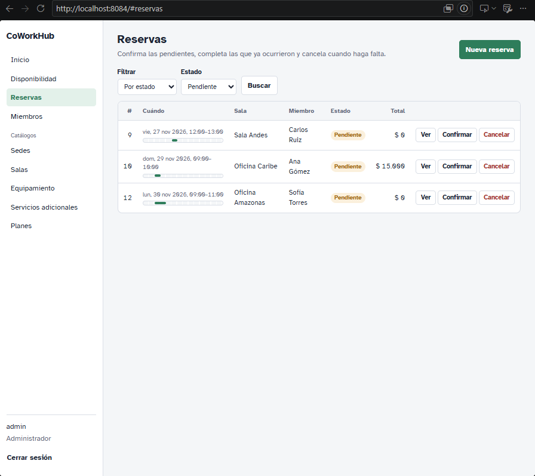
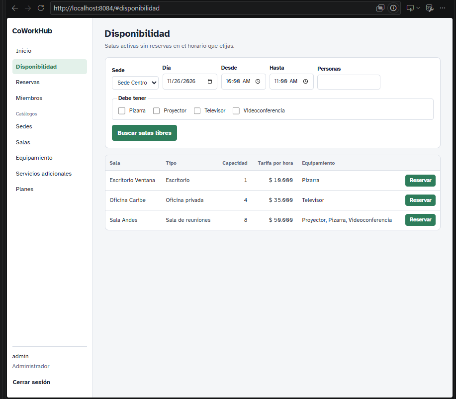
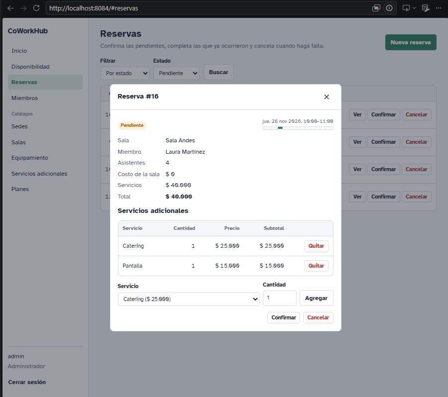
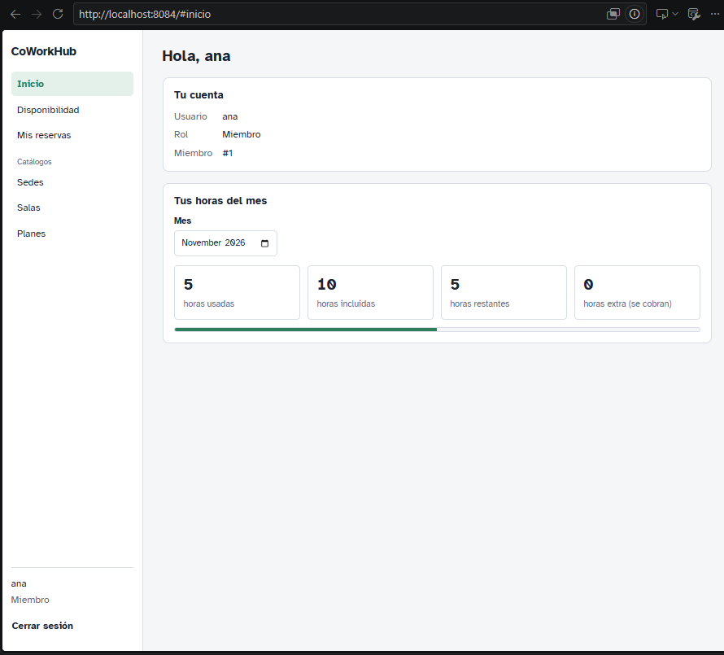
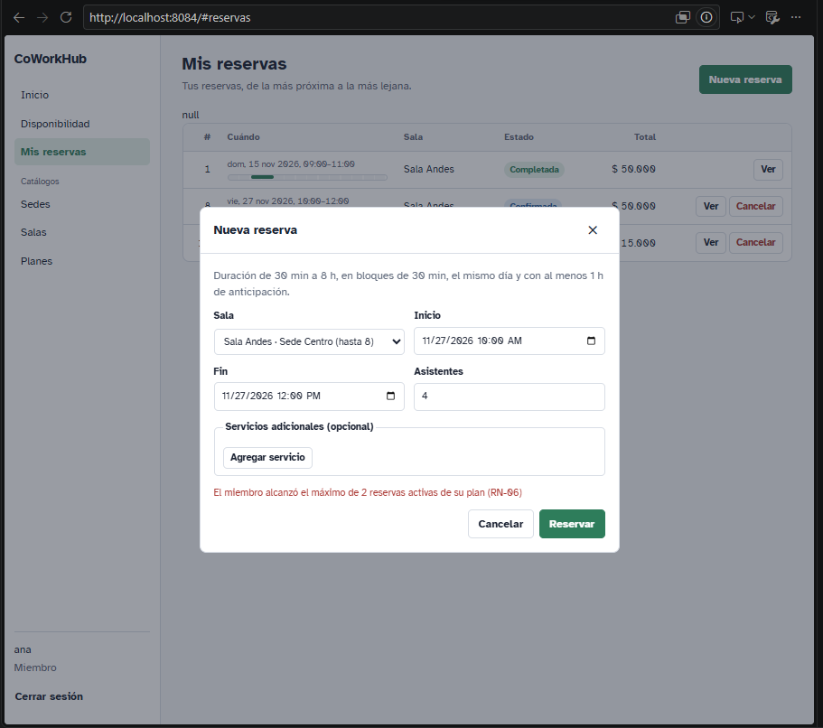
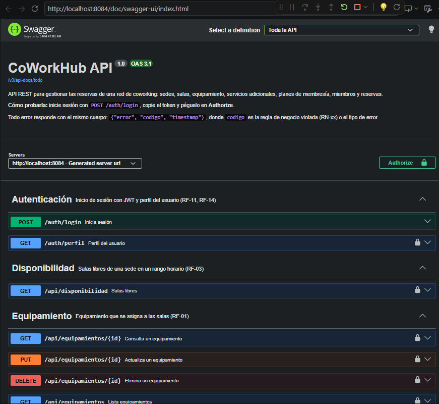
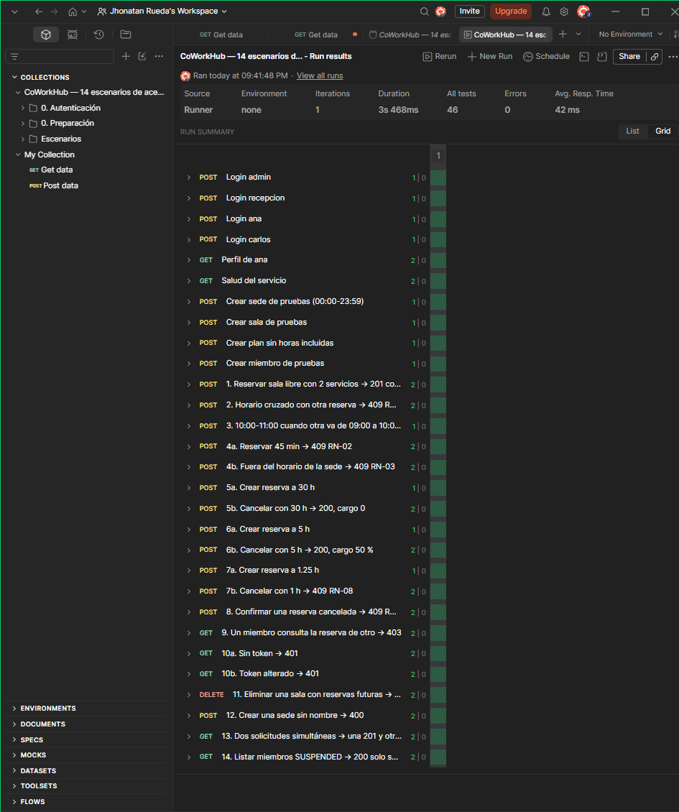
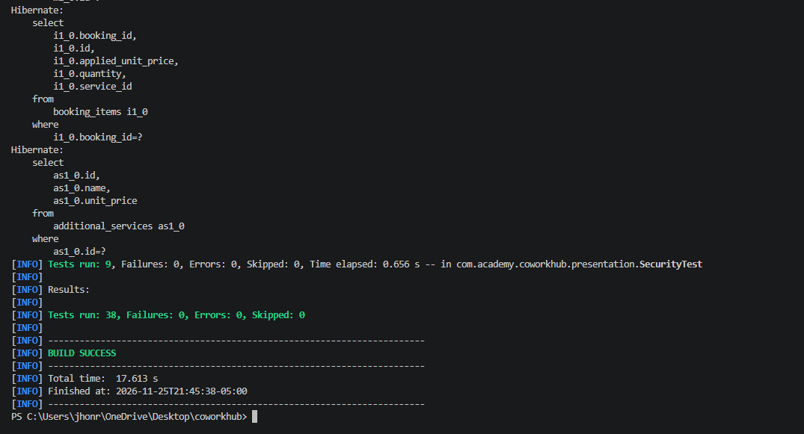

# CoWorkHub

Sistema de reservas para una red de coworking. Permite administrar sedes, salas,
equipamiento, servicios adicionales, planes de membresía y miembros, y reservar salas
evitando cruces de horario, controlando las horas que consume cada miembro y cobrando las
cancelaciones siempre con la misma regla. Cada usuario solo puede hacer lo que le permite
su rol.

El proyecto tiene dos partes que se ejecutan juntas:

- **Backend:** API REST con Spring Boot, protegida con JWT.
- **Frontend:** panel web en HTML, CSS y JavaScript, servido por el mismo Spring Boot en
  `http://localhost:8084/`.

## Contenido

1. [Integrantes](#1-integrantes)
2. [Tecnologías utilizadas](#2-tecnologías-utilizadas)
3. [Requisitos previos](#3-requisitos-previos)
4. [Instalación](#4-instalación)
5. [Preparar MySQL](#5-preparar-mysql)
6. [Variables de entorno](#6-variables-de-entorno)
7. [Ejecutar el backend y el frontend](#7-ejecutar-el-backend-y-el-frontend)
8. [Roles](#8-roles)
9. [Swagger](#9-swagger)
10. [Datos de prueba](#10-datos-de-prueba)
11. [Pruebas y colección de Postman](#11-pruebas-y-colección-de-postman)
12. [Evidencias de funcionamiento](#12-evidencias-de-funcionamiento)
13. [Estructura del proyecto](#13-estructura-del-proyecto)

## 1. Integrantes

| Nombre | Rol en el proyecto |
|---|---|
| Jhonatan David Rueda Galeano | Desarrollo del backend, el frontend y la documentación |

## 2. Tecnologías utilizadas

| Parte | Tecnología |
|---|---|
| Lenguaje del backend | Java 21 |
| Framework | Spring Boot 4.1.3 (Web MVC, Data JPA, Validation, Security, Actuator) |
| Seguridad | Spring Security con JWT (`spring-boot-starter-security-oauth2-resource-server`, Nimbus JOSE + JWT, HS256) y contraseñas con BCrypt |
| Persistencia | Hibernate / JPA, MySQL 8 (`mysql-connector-j`) |
| Documentación de la API | springdoc-openapi 3.2.1 (Swagger UI) |
| Utilidades | Lombok |
| Frontend | HTML5, CSS3 y JavaScript sin frameworks (`fetch` contra la API) |
| Construcción | Maven (incluye el *wrapper* `mvnw`) |
| Pruebas | JUnit 5, Spring Boot Test, MockMvc, Spring Security Test; Postman / Newman |
| Base de datos local | Docker (imagen `mysql:8.4`) o MySQL instalado |

## 3. Requisitos previos

| Herramienta | Versión | Para qué |
|---|---|---|
| JDK | 21 | Compilar y ejecutar el backend (`java -version`) |
| MySQL | 8.x | Base de datos. Puede ser **Docker** o un MySQL instalado |
| Docker Desktop | cualquiera reciente | Solo si usa MySQL en Docker |
| Navegador | Chrome, Edge o Firefox actual | Usar el panel web y Swagger |
| Git | cualquiera | Clonar el repositorio |
| Node.js | 18 o superior (opcional) | Solo para correr la colección de Postman desde la terminal con `npx newman` |

No hace falta instalar Maven: el proyecto trae `mvnw` (Linux/macOS) y `mvnw.cmd` (Windows),
que lo descargan la primera vez. El frontend no necesita instalación: son archivos
estáticos que entrega el backend.

## 4. Instalación

```bash
git clone https://github.com/jhonrue28/coworkhub.git
cd coworkhub
```

Descargar las dependencias y compilar (la primera vez tarda unos minutos):

```bash
./mvnw clean install -DskipTests        # Windows: mvnw.cmd clean install -DskipTests
```

Si abre el proyecto en IntelliJ, VS Code o Eclipse, importe el `pom.xml` como proyecto
Maven. Si el editor marca errores de dependencias, recargue Maven: en IntelliJ, *Reload All
Maven Projects*; en VS Code o Eclipse, *Update Project* con *Force Update*.

## 5. Preparar MySQL

La aplicación se conecta con estos datos (`src/main/resources/application.properties`):

| Dato | Valor |
|---|---|
| URL | `jdbc:mysql://localhost:3306/coworkhub` |
| Usuario | `coworkhub` |
| Contraseña | `coworkhub` (o la variable `DB_PASSWORD`) |

Las tablas **no se crean a mano**: Hibernate las crea al arrancar y carga los datos de
prueba (ver [sección 10](#10-datos-de-prueba)). Solo hay que tener la base y el usuario.

### Opción A: Docker (recomendada)

```bash
docker run -d --name coworkhub-mysql -e MYSQL_DATABASE=coworkhub -e MYSQL_USER=coworkhub -e MYSQL_PASSWORD=coworkhub -e MYSQL_ROOT_PASSWORD=root -p 3306:3306 -v coworkhub-datos:/var/lib/mysql mysql:8.4
```

La primera vez, espere a que `docker logs coworkhub-mysql` muestre `ready for connections`.

| Para… | Comando |
|---|---|
| Ver si está corriendo | `docker ps` |
| Detenerlo / iniciarlo | `docker stop coworkhub-mysql` · `docker start coworkhub-mysql` |
| Consola de MySQL (contraseña `coworkhub`) | `docker exec -it coworkhub-mysql mysql -u coworkhub -p coworkhub` |
| Borrarlo con sus datos | `docker rm -f coworkhub-mysql` y `docker volume rm coworkhub-datos` |

Si el puerto 3306 está ocupado, use `-p 3307:3306` y cambie el puerto en
`spring.datasource.url`.

### Opción B: MySQL instalado

Con un usuario administrador (`mysql -u root -p`):

```sql
CREATE DATABASE coworkhub CHARACTER SET utf8mb4 COLLATE utf8mb4_unicode_ci;
CREATE USER 'coworkhub'@'localhost' IDENTIFIED BY 'coworkhub';
GRANT ALL PRIVILEGES ON coworkhub.* TO 'coworkhub'@'localhost';
FLUSH PRIVILEGES;
```

Si prefiere otra contraseña, defínala en `DB_PASSWORD` (sección 6).

## 6. Variables de entorno

Todas son opcionales: sin ellas la aplicación usa los valores de desarrollo.

> ⚠️ **Advertencia educativa.** La clave de firma JWT por defecto, la contraseña de MySQL
> (`coworkhub`) y las contraseñas de los usuarios de prueba (`admin123`, `ana123`…) están
> en el repositorio **a propósito**, para que el proyecto se pueda ejecutar y evaluar sin
> configuración. Son valores de desarrollo, no secretos reales, y los miembros de
> `import.sql` son personas ficticias. En un entorno real esos valores nunca se suben al
> repositorio: se definen con estas variables de entorno o con un gestor de secretos.

| Variable | Qué configura | Valor por defecto |
|---|---|---|
| `DB_PASSWORD` | Contraseña del usuario `coworkhub` de MySQL | `coworkhub` |
| `JWT_SECRET` | Secreto con el que se firman los tokens (HS256). Debe tener **al menos 32 caracteres**; si no, la aplicación no arranca | Un secreto de desarrollo. **Cámbielo fuera de su equipo** |

Cómo definirlas antes de arrancar:

```powershell
# Windows (PowerShell), solo para esa ventana
$env:DB_PASSWORD = "mi-clave"
$env:JWT_SECRET  = "un-secreto-largo-de-al-menos-32-caracteres"
```

```bash
# Linux / macOS
export DB_PASSWORD=mi-clave
export JWT_SECRET=un-secreto-largo-de-al-menos-32-caracteres
```

También puede crear un archivo `local.properties` en la raíz del proyecto (git lo ignora):

```properties
spring.datasource.password=mi-clave
coworkhub.jwt.secret=un-secreto-largo-de-al-menos-32-caracteres
```

Otras propiedades del negocio, en `application.properties`:

| Propiedad | Valor | Significado |
|---|---|---|
| `server.port` | `8084` | Puerto de la aplicación (el 8080 estaba ocupado en el equipo de desarrollo) |
| `coworkhub.zone-id` | `America/Bogota` | Zona horaria para "ahora" (anticipación y cancelaciones) |
| `coworkhub.jwt.expiration-minutes` | `60` | Minutos de validez del token |

## 7. Ejecutar el backend y el frontend

Con MySQL corriendo:

```bash
./mvnw spring-boot:run                  # Windows: mvnw.cmd spring-boot:run
```

O desde el editor, ejecutando la clase `CoworkhubApplication`.

**El frontend arranca con el backend**: no tiene un comando aparte. Sus archivos están en
`src/main/resources/static/` y Spring Boot los entrega en la misma dirección.

| Qué | Dirección |
|---|---|
| **Panel web (frontend)** | http://localhost:8084/ |
| API REST | http://localhost:8084/api/... |
| Swagger UI | http://localhost:8084/doc/swagger-ui.html |
| Salud del servicio | http://localhost:8084/actuator/health → `{"status":"UP"}` |

Importante:

- Con `spring.jpa.hibernate.ddl-auto=create`, **cada arranque borra las tablas, las crea
  de nuevo y carga los datos de prueba**. Lo que se cree a mano se pierde al reiniciar.
- Si escribe `http://localhost:8084/api/sedes` en el navegador, recibe
  `401 "Se requiere un token válido"`. Es lo esperado: la API exige un JWT. Use el panel
  web, Swagger o Postman, que envían el token.

### Uso del panel web

1. Abra http://localhost:8084/ e inicie sesión con un usuario de prueba (sección 10).
2. El menú de la izquierda cambia según el rol (sección 8).
3. El token se guarda solo mientras la pestaña está abierta. Si vence (60 min), el panel
   vuelve al inicio de sesión.

| Sección del panel | Qué se hace ahí |
|---|---|
| Inicio | Datos de la cuenta. Un miembro ve sus horas del mes; recepción y administración ven cuántas reservas faltan por confirmar |
| Disponibilidad | Buscar salas libres por sede, día, horario, personas y equipamiento, y reservar desde el resultado |
| Reservas / Mis reservas | Crear reservas con servicios, ver el detalle, agregar o quitar servicios, confirmar, completar y cancelar. Cada reserva se muestra como una barra dentro del día (07:00 a 21:00) |
| Miembros | Registrar miembros con su usuario, editar, suspender, activar, eliminar y ver su consumo |
| Catálogos | Sedes, salas, equipamiento, servicios adicionales y planes: consultar y, si es `ADMIN`, crear, editar y eliminar. El `MEMBER` solo ve sedes, salas y planes: el equipamiento lo filtra en *Disponibilidad* y los servicios los elige al reservar |

## 8. Roles

| Rol | Qué puede hacer |
|---|---|
| `ADMIN` | Todo. Es el único que crea, modifica o elimina catálogos (sedes, salas, equipamiento, servicios y planes). |
| `RECEPTIONIST` | Gestiona los miembros (registrar, editar, suspender, activar, eliminar, ver consumo) y todas las reservas (crear, confirmar, completar, cancelar). Consulta los catálogos. |
| `MEMBER` | Consulta catálogos y disponibilidad. Crea, ve, modifica (servicios) y cancela **solo sus** reservas, y ve **solo su** consumo. Si intenta ver datos de otro miembro recibe `403`. |

Permisos por endpoint:

| Recurso | Lectura | Escritura |
|---|---|---|
| `/auth/login`, `/actuator/health`, Swagger, panel web | Público | — |
| `/auth/perfil`, `/api/disponibilidad` | Cualquier usuario autenticado | — |
| Catálogos (`/api/sedes`, `/api/salas`, `/api/equipamientos`, `/api/servicios-adicionales`, `/api/planes`) | Cualquier usuario autenticado | `ADMIN` |
| `/api/miembros` | `ADMIN`, `RECEPTIONIST`; el `MEMBER` solo el suyo y su consumo | `ADMIN`, `RECEPTIONIST` |
| `/api/reservas` | `ADMIN`, `RECEPTIONIST`; el `MEMBER` solo las suyas | Crear, servicios y cancelar: `ADMIN`, `RECEPTIONIST` y el `MEMBER` dueño. Confirmar y completar: `ADMIN`, `RECEPTIONIST` |

## 9. Swagger

- **Swagger UI:** http://localhost:8084/doc/swagger-ui.html
- Especificación OpenAPI: http://localhost:8084/v3/api-docs/todo (copia exportada en
  [`docs/openapi.json`](docs/openapi.json))

Para probar endpoints protegidos:

1. Ejecute `POST /auth/login` con `{"username": "admin", "password": "admin123"}`.
2. Copie el valor de `token`.
3. Pulse **Authorize**, pegue el token y confirme.

Todo error de la API responde con el mismo cuerpo:

```json
{"error": "La sala ya está reservada en ese horario", "codigo": "RN-01", "timestamp": "2030-06-03T13:00:00Z"}
```

`codigo` es la regla de negocio violada (`RN-xx`) o el tipo de error (`DATOS_INVALIDOS`,
`NO_ENCONTRADO`, `NO_AUTENTICADO`, `ACCESO_DENEGADO`, …).

## 10. Datos de prueba

Los datos de prueba están en **`src/main/resources/import.sql`**. Hibernate lo ejecuta solo
en cada arranque, justo después de crear las tablas. El archivo carga:

| Datos | Cantidad |
|---|---|
| Sedes | 2 |
| Salas | 6 (una inactiva), con su equipamiento |
| Equipamiento | 4 |
| Servicios adicionales | 3 |
| Planes de membresía | 3 |
| Miembros | 5 (uno suspendido) |
| Usuarios | 4 |
| Reservas | 15 en todos los estados, algunas con servicios |

Las fechas de las reservas se calculan desde el día actual, así que siempre hay reservas
pasadas y futuras. Las contraseñas están guardadas con BCrypt.

**Usuarios de prueba:**

| Usuario | Contraseña | Rol | Miembro |
|---|---|---|---|
| `admin` | `admin123` | `ADMIN` | — |
| `recepcion` | `recepcion123` | `RECEPTIONIST` | — |
| `ana` | `ana123` | `MEMBER` | 1 · Ana Gómez |
| `carlos` | `carlos123` | `MEMBER` | 2 · Carlos Ruiz |

## 11. Pruebas y colección de Postman

### Pruebas automáticas

Con MySQL corriendo:

```bash
./mvnw test                             # Windows: mvnw.cmd test
```

### Colección de Postman

[`docs/coworkhub.postman_collection.json`](docs/coworkhub.postman_collection.json) contiene
los 14 escenarios de aceptación, cada uno con sus verificaciones.

1. Arranque la aplicación (así los datos quedan como al inicio).
2. En Postman: **Import** → el archivo → **Run collection**.

La carpeta *0. Autenticación* inicia sesión con los cuatro usuarios y guarda los tokens en
variables de la colección. *0. Preparación* crea un plan sin horas incluidas y una sede
abierta todo el día, para que los escenarios de cancelación funcionen a cualquier hora.
Para correrla otra vez, reinicie la aplicación.

Desde la terminal:

```bash
npx newman run docs/coworkhub.postman_collection.json
```

| # | Escenario | Resultado esperado |
|---|---|---|
| 1 | Reservar una sala libre con 2 servicios | `201` con el costo calculado |
| 2 | Reservar en un horario que se cruza con otra reserva | `409` `RN-01` |
| 3 | Reservar de 10:00 a 11:00 cuando otra va de 09:00 a 10:00 | `201` |
| 4 | Reservar 45 min, o fuera del horario de la sede | `409` |
| 5 | Cancelar con 30 h de anticipación | `200`, cargo 0 |
| 6 | Cancelar con 5 h de anticipación | `200`, cargo del 50 % |
| 7 | Cancelar con 1 h de anticipación | `409` |
| 8 | Confirmar una reserva cancelada | `409` |
| 9 | Un miembro consulta la reserva de otro | `403` |
| 10 | Llamar a un endpoint protegido sin token, o con un token alterado | `401` |
| 11 | Eliminar una sala con reservas futuras | `409` |
| 12 | Crear una sede sin nombre | `400` |
| 13 | Enviar dos solicitudes simultáneas para la misma sala y horario | Una `201` y la otra `409` |
| 14 | Listar miembros con `?estado=SUSPENDED` | `200` solo con los miembros suspendidos |

## 12. Evidencias de funcionamiento

### Pruebas automáticas (`mvnw test`)

Resultado de la última ejecución: **38 pruebas, 0 fallos, 0 errores**.

| Clase de prueba | Pruebas | Qué cubre |
|---|---|---|
| `BookingServiceTest` | 11 | Reservas: costo, cruces, duración y horario, cancelaciones, transiciones, servicios, consumo, disponibilidad y listados |
| `CatalogAndMemberServiceTest` | 5 | Catálogos y miembros: duplicados, no eliminar lo que está en uso, filtro de suspendidos |
| `ConcurrentBookingTest` | 1 | Dos reservas simultáneas en la misma sala: una pasa y la otra recibe `409` |
| `ImportDataTest` | 2 | Que `import.sql` carga los datos y las contraseñas en BCrypt |
| `ErrorResponseTest` | 8 | Códigos `400`, `404`, `405` y `409` con el cuerpo de error único |
| `SecurityTest` | 9 | Login, perfil, `401` (sin token, alterado, vencido), `403` y permisos por rol |
| `OpenApiDocsTest` | 1 | Que Swagger documenta los códigos de respuesta que cada endpoint puede devolver, y solo esos |
| `CoworkhubApplicationTests` | 1 | Que la aplicación arranca |

### Colección de Postman (`npx newman run`)

Resultado de la última ejecución: **los 14 escenarios pasaron, 46 verificaciones y 0 fallos**.

### Panel web

Se recorrió el panel contra la aplicación en ejecución con un navegador simulado (jsdom),
con **15 comprobaciones y 0 fallos**:

| Usuario | Qué se comprobó |
|---|---|
| `carlos` (`MEMBER`) | El menú no incluye Miembros, Equipamiento ni Servicios adicionales. *Ver* abre el detalle de reservas completadas, canceladas, pendientes y confirmadas. La barra de horario se dibuja en su posición. Sin errores de JavaScript. |
| `admin` | Una reserva pendiente ofrece agregar servicios. Al confirmarla desde el detalle, el detalle pasa a *Confirmada* y deja de ofrecer *Confirmar* y agregar servicios. Sin errores de JavaScript. |

### Capturas de pantalla

**1. Inicio de sesión.** 


**2. Panel del administrador.** 



**3. Disponibilidad.** 



**4. Reserva creada con costo.** 



**5. Panel del miembro.** 



**6. Regla de negocio en acción.** Ana, que ya tiene las 2 reservas activas que permite su
plan, intenta crear una tercera: el sistema la rechaza con el aviso `RN-06`.



**7. Swagger.**



**8. Postman.** 



**9. Pruebas automáticas.** 



## 13. Estructura del proyecto

```
coworkhub/
├── pom.xml                         dependencias y configuración de Maven
├── mvnw, mvnw.cmd                  Maven wrapper
├── requerimientos.md               enunciado del proyecto
├── plan.md                         plan por fases y estado de cada una
├── docs/
│   ├── analisis.md                 actores, casos de uso, glosario, ER, trazabilidad y supuestos
│   ├── openapi.json                especificación de la API exportada
│   ├── coworkhub.postman_collection.json
│   └── evidencias/                 capturas de pantalla
└── src/
    ├── main/
    │   ├── java/com/academy/coworkhub/
    │   │   ├── config/             Clock, PasswordEncoder, JWT, seguridad, OpenAPI
    │   │   ├── presentation/
    │   │   │   ├── controller/     @RestController (uno por recurso) y /auth
    │   │   │   ├── dto/            records de entrada (@Valid) y de salida
    │   │   │   └── advice/         @RestControllerAdvice con el cuerpo de error único
    │   │   ├── business/
    │   │   │   ├── service/(impl)  interfaces e implementaciones (@Transactional)
    │   │   │   ├── security/       login JWT, carga de usuarios y dueño del recurso
    │   │   │   └── exception/      excepciones de negocio
    │   │   └── persistence/
    │   │       ├── entity/         entidades JPA y enums
    │   │       └── repository/     repositorios Spring Data
    │   └── resources/
    │       ├── application.properties
    │       ├── import.sql          datos de prueba
    │       └── static/             frontend: index.html, styles.css, app.js
    └── test/                       pruebas JUnit y MockMvc
```
