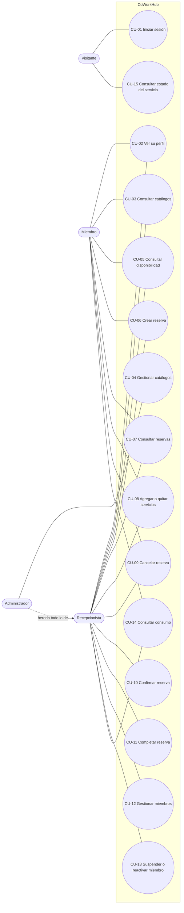
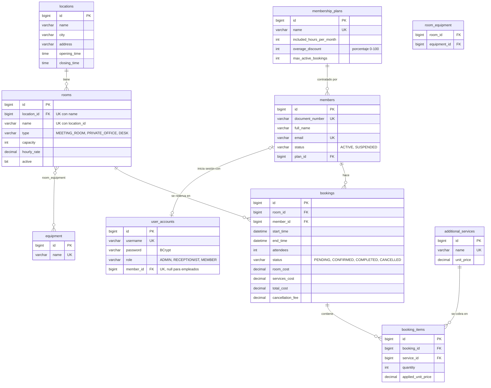

# Análisis — CoWorkHub

Documento de análisis de la API de reservas de CoWorkHub. Describe los actores y casos de
uso, el vocabulario del negocio, el modelo de datos con sus decisiones de mapeo, la
trazabilidad de los requisitos y los supuestos tomados donde el enunciado
(`requerimientos.md`) no era explícito. Todo lo descrito coincide con el código entregado.

---

## 1. Actores y casos de uso

### 1.1. Actores

| Actor | Rol en el sistema | Descripción |
|---|---|---|
| **Administrador** | `ADMIN` | Empleado que configura el coworking. Es el único que crea, modifica o elimina catálogos (sedes, salas, equipamiento, servicios adicionales y planes). Además puede hacer todo lo que hace la recepción. |
| **Recepcionista** | `RECEPTIONIST` | Empleado que atiende a los clientes. Gestiona los miembros y todas las reservas: crea reservas a nombre de cualquier miembro, las confirma, las completa y las cancela. Consulta los catálogos, pero no los modifica. |
| **Miembro** | `MEMBER` | Cliente del coworking con un plan de membresía. Consulta catálogos y disponibilidad, y crea, consulta, modifica (servicios) y cancela **solo sus** reservas; consulta **solo su** consumo. |
| **Visitante** | sin token | Cualquiera sin sesión. Solo puede iniciar sesión, ver la documentación (Swagger) y consultar el estado del servicio. |

### 1.2. Diagrama de casos de uso

> El administrador tiene todos los casos de uso de la recepcionista más CU-04. Los casos
> CU-06 a CU-09 y CU-14, para el miembro, se limitan a sus propios datos.

### 1.3. Descripción de los casos de uso

| Caso | Actores | Descripción breve | Reglas |
|---|---|---|---|
| **CU-01 Iniciar sesión** | Visitante | Envía usuario y contraseña; si son correctos recibe un JWT que vence en 60 min. Si no, `401`. | — |
| **CU-02 Ver su perfil** | Todos los autenticados | Consulta su usuario, rol y `miembroId` (vacío para empleados), leídos del token. | — |
| **CU-03 Consultar catálogos** | Todos los autenticados | Lista o consulta sedes, salas (filtrables por sede), equipamiento, servicios adicionales y planes. | — |
| **CU-04 Gestionar catálogos** | Administrador | Crea, modifica y elimina elementos de los catálogos. Una sala se registra con su sede y su equipamiento. | RN-11, RN-12 |
| **CU-05 Consultar disponibilidad** | Todos los autenticados | Indica sede, fecha y rango horario (y opcionalmente capacidad mínima y equipamiento) y obtiene las salas activas libres. | RN-01, RN-04 |
| **CU-06 Crear reserva** | Miembro (a su nombre), Recepcionista, Administrador | Reserva una sala para un horario y un número de asistentes, opcionalmente con servicios. El sistema valida las reglas, calcula el costo y deja la reserva `PENDING`. | RN-01 a RN-07 |
| **CU-07 Consultar reservas** | Miembro (las suyas), Recepcionista, Administrador | Consulta una reserva, o lista por miembro, por sala y fecha, o por estado. El miembro solo puede listar con su propio `miembroId`. | RN-13 |
| **CU-08 Agregar o quitar servicios** | Miembro (las suyas), Recepcionista, Administrador | Agrega un servicio (o suma cantidad si ya estaba) o lo quita; el costo se recalcula. | RN-07, RN-10 |
| **CU-09 Cancelar reserva** | Miembro (las suyas), Recepcionista, Administrador | Cancela según la anticipación y devuelve el cargo aplicado. | RN-08, RN-09 |
| **CU-10 Confirmar reserva** | Recepcionista, Administrador | Pasa una reserva `PENDING` a `CONFIRMED`. | RN-09 |
| **CU-11 Completar reserva** | Recepcionista, Administrador | Pasa una reserva `CONFIRMED` a `COMPLETED`. | RN-09 |
| **CU-12 Gestionar miembros** | Recepcionista, Administrador | Registra un miembro junto con su cuenta, lo consulta, lo lista (filtros por nombre y estado), lo modifica (nombre, email, plan) y lo elimina. El miembro puede consultar solo su propia ficha. | RN-11, RN-12 |
| **CU-13 Suspender o reactivar miembro** | Recepcionista, Administrador | Cambia el estado del miembro entre `ACTIVE` y `SUSPENDED`. Un suspendido no puede reservar. | RN-05 |
| **CU-14 Consultar consumo** | Miembro (el suyo), Recepcionista, Administrador | Muestra, para un mes, las horas incluidas en el plan, las usadas, las restantes y las excedentes. | RN-07 |
| **CU-15 Consultar estado del servicio** | Visitante | `GET /actuator/health` responde `{"status":"UP"}`. | — |

---

## 2. Glosario

| Término | Definición |
|---|---|
| **Reserva** | Uso de una sala por un miembro entre una hora de inicio y una de fin del mismo día, con un número de asistentes y, opcionalmente, servicios adicionales. Nace `PENDING`, puede pasar a `CONFIRMED` y luego a `COMPLETED`, o a `CANCELLED` desde `PENDING` o `CONFIRMED` (RN-09). Guarda su costo de sala, de servicios, total y, si se cancela, el cargo. |
| **Plan** (de membresía) | Condiciones que contrata un miembro: cuántas horas al mes no se le cobran, qué descuento tienen las horas que pasen de ahí y cuántas reservas activas futuras puede tener a la vez. Todo miembro tiene exactamente un plan. |
| **Horas incluidas** | Horas de sala que el plan regala cada mes calendario. Se consumen en el orden en que se crean las reservas; las reservas `CANCELLED` no las consumen. |
| **Horas excedentes** | Horas de una reserva que superan las horas incluidas que le quedaban al miembro en ese mes. Se cobran a `tarifaHora × (1 − descuento)` (RN-07). |
| **Solapamiento** | Dos reservas `PENDING` o `CONFIRMED` de la misma sala se solapan si una empieza antes de que la otra termine y termina después de que la otra empiece. Si una termina exactamente cuando empieza la otra, **no** se solapan (RN-01). |
| **Cargo por cancelación** | Monto que se cobra al cancelar: 0 con 24 h o más de anticipación; el 50 % del costo de la sala con menos de 24 h y al menos 2 h; con menos de 2 h, o si la reserva ya empezó, no se puede cancelar (RN-08). Los servicios no generan cargo. |
| Reserva activa | Reserva `PENDING` o `CONFIRMED` cuyo inicio aún no llega. Es la que cuenta para `maxActiveBookings` (RN-06). |
| Miembro | Cliente del coworking. Puede tener o no una cuenta para iniciar sesión. Los empleados no son miembros. |
| Cuenta (`UserAccount`) | Usuario, contraseña (BCrypt) y rol con que se inicia sesión. La de un miembro está unida a él; la de un empleado no. |

---

## 3. Modelo de datos

### 3.1. Diagrama entidad-relación

Es el esquema que Hibernate genera a partir de las entidades (`ddl-auto=create`).
`PK` = clave primaria, `FK` = clave foránea, `UK` = única.

**Tipos de datos.** El dinero es `BigDecimal` (`DECIMAL(10,2)`) porque `double` no
representa exactamente los decimales. Las fechas y horas son `LocalDateTime` y
`LocalTime`, siempre en hora de Bogotá (`coworkhub.zone-id`). Los enumerados se guardan con
`@Enumerated(EnumType.STRING)`, para que reordenar el `enum` no cambie el significado de los
datos guardados. Las columnas obligatorias llevan `nullable = false`.

### 3.2. Justificación de cada relación

**Criterio general:**

- **Dueño:** el lado dueño es siempre el que tiene la clave foránea en su tabla. En una
  relación N → 1 es el lado N, porque una fila no puede guardar una lista.
- **`fetch`:** todas las relaciones son `LAZY`, también las `@ManyToOne`, cuyo valor por
  defecto es `EAGER`. Así ninguna consulta trae datos que no va a usar. Cuando un listado sí
  los necesita, los pide explícitamente con `@EntityGraph`, en la misma consulta, sin N+1.
- **`cascade`:** solo existe donde el hijo no tiene sentido sin el padre. Entre entidades
  independientes no hay `cascade`: guardar o borrar una no debe arrastrar a la otra, y RN-12
  exige que el borrado se rechace, no que se propague.
- **Respuestas JSON:** la API nunca devuelve entidades, sino DTO (`record`) armados dentro
  de la transacción. Por eso no hay `LazyInitializationException`
  (`spring.jpa.open-in-view=false`) ni referencias circulares.

| Relación | Tipo | Lado dueño (FK) | `fetch` | `cascade` | Justificación |
|---|---|---|---|---|---|
| Sede → Salas | 1 → N, bidireccional | `Room.location` (`rooms.location_id`) | `LAZY` en ambos lados | Ninguno | Una sala pertenece a una sede; la FK solo puede estar en `rooms`. `Location.rooms` es el lado inverso (`mappedBy`) y solo se usa para consultas. Sin `cascade`: una sede con salas no se borra (RN-12) y las salas se crean por su propio endpoint. |
| Sala ↔ Equipamiento | N ↔ N, unidireccional | `Room.equipment` (`@JoinTable room_equipment`) | `LAZY` | Ninguno | El equipamiento se asigna a la sala, y es la sala la que se edita con su lista de equipos (`equipamientoIds`). El equipamiento no necesita conocer sus salas, y "¿está en uso?" (RN-12) se responde con `existsByEquipment_Id`. Sin `cascade`: el equipamiento es un catálogo independiente. Al borrar una sala, Hibernate borra solo sus filas de `room_equipment`. |
| Plan → Miembros | 1 → N, unidireccional | `Member.plan` (`members.plan_id`, obligatorio) | `LAZY` | Ninguno | Todo miembro tiene un plan. El plan no necesita la lista de miembros: RN-12 se valida con `existsByPlanId`. Cambiar o borrar un plan no debe tocar miembros. |
| Miembro ↔ Cuenta | 0..1 ↔ 0..1, unidireccional | `UserAccount.member` (`user_accounts.member_id`, único, admite `null`) | `LAZY` | Ninguno | La FK va en la cuenta porque los empleados tienen cuenta pero no miembro: con la FK en `members`, todo miembro necesitaría cuenta. `unique = true` la hace 1 a 1. Sin `cascade`: `MemberServiceImpl` crea y borra los dos explícitamente, en una sola transacción. |
| Miembro → Reservas | 1 → N, unidireccional | `Booking.member` (`bookings.member_id`) | `LAZY` | Ninguno | La reserva conoce a su miembro; el miembro no carga su historial. Las reservas de un miembro se buscan con consultas derivadas (`findByMemberId…`). Un miembro con reservas no se borra (RN-12). |
| Sala → Reservas | 1 → N, unidireccional | `Booking.room` (`bookings.room_id`) | `LAZY` | Ninguno | Igual que la anterior. El cruce de horarios se busca con `existsByRoomId…`, con la sala bloqueada (`PESSIMISTIC_WRITE`) para RN-01 concurrente. |
| Reserva → Detalles | 1 → N, bidireccional (composición) | `BookingItem.booking` (`booking_items.booking_id`) | `LAZY` | `ALL` + `orphanRemoval = true` en `Booking.items` | El detalle **pertenece** a la reserva: se crea con ella, se guarda con ella y, si se quita de la lista (`removeItem`), se borra de la base. Es la única relación con `cascade`. `addItem`/`removeItem` mantienen sincronizados los dos lados. |
| Servicio → Detalles | 1 → N, unidireccional | `BookingItem.service` (`booking_items.service_id`) | `LAZY` | Ninguno | El detalle apunta al servicio que cobra. El servicio no conoce sus detalles: RN-12 usa `existsByServiceId`. El precio no se lee del servicio después: se copia en `appliedUnitPrice` al agregarlo (RN-07). |

### 3.3. Restricciones de unicidad

| Dato único | En la base | En el servicio (mensaje claro, `409 RN-11`) |
|---|---|---|
| Documento del miembro | `members.document_number` `unique` | `existsByDocumentNumber` |
| Email del miembro (sin distinguir mayúsculas) | `members.email` `unique` | `existsByEmailIgnoreCase` |
| Usuario | `user_accounts.username` `unique` | `existsByUsername` |
| Nombre de sala dentro de su sede | `uk_room_location_name (location_id, name)` | `existsByLocationIdAndNameIgnoreCase` |
| Nombre de equipamiento, servicio y plan | `unique` en cada `name` | `existsByNameIgnoreCase` |

La validación en el servicio da el mensaje de negocio. La restricción en la base es la red
de seguridad si dos solicitudes iguales llegan a la vez: `GlobalExceptionHandler` traduce la
`DataIntegrityViolationException` a `409`.

---

## 4. Matriz de trazabilidad

Cada requisito funcional enlazado a las reglas que aplica, los endpoints que lo implementan,
el caso de uso y dónde se prueba. No hay RF sin endpoint ni endpoint sin RF.

| RF | Requisito | RN | Endpoints | CU | Prueba |
|---|---|---|---|---|---|
| **RF-01** | CRUD de catálogos | RN-11, RN-12, RN-13 | `GET/POST /api/{sedes, salas, equipamientos, servicios-adicionales, planes}`, `GET/PUT/DELETE /api/{recurso}/{id}` (salas acepta `?sedeId=`) | CU-03, CU-04 | `CatalogAndMemberServiceTest`, `SecurityTest`, Postman esc. 11 y 12 |
| **RF-02** | Gestión de miembros con su usuario | RN-11, RN-12, RN-13 | `GET /api/miembros?nombre=&estado=`, `GET/PUT/DELETE /api/miembros/{id}`, `POST /api/miembros`, `PATCH /api/miembros/{id}/suspender`, `PATCH /api/miembros/{id}/activar` | CU-12, CU-13 | `CatalogAndMemberServiceTest`, `SecurityTest`, Postman esc. 14 |
| **RF-03** | Salas libres | RN-01, RN-04 | `GET /api/disponibilidad?sedeId=&fecha=&horaInicio=&horaFin=&capacidadMinima=&equipamientoIds=` | CU-05 | `BookingServiceTest` |
| **RF-04** | Crear reserva con costo | RN-01 a RN-07, RN-13 | `POST /api/reservas` | CU-06 | `BookingServiceTest`, `ConcurrentBookingTest`, Postman esc. 1 a 4 y 13 |
| **RF-05** | Consultar y listar reservas | RN-13 | `GET /api/reservas/{id}`, `GET /api/reservas?miembroId=` · `?salaId=&fecha=` · `?estado=` | CU-07 | `BookingServiceTest`, `SecurityTest`, Postman esc. 9 |
| **RF-06** | Agregar o quitar servicios | RN-07, RN-10, RN-13 | `POST /api/reservas/{id}/servicios`, `DELETE /api/reservas/{id}/servicios/{servicioId}` | CU-08 | `BookingServiceTest` |
| **RF-07** | Confirmar | RN-09, RN-13 | `POST /api/reservas/{id}/confirmar` | CU-10 | `BookingServiceTest`, Postman esc. 8 |
| **RF-08** | Cancelar con cargo | RN-08, RN-09, RN-13 | `POST /api/reservas/{id}/cancelar` | CU-09 | `BookingServiceTest`, Postman esc. 5 a 7 |
| **RF-09** | Completar | RN-09, RN-13 | `POST /api/reservas/{id}/completar` | CU-11 | `BookingServiceTest` |
| **RF-10** | Consumo mensual | RN-07, RN-13 | `GET /api/miembros/{id}/consumo?mes=yyyy-MM` | CU-14 | `BookingServiceTest`, `SecurityTest` |
| **RF-11** | Login con JWT de 60 min | — | `POST /auth/login` | CU-01 | `SecurityTest` |
| **RF-12** | JWT obligatorio y permisos | RN-13 | Todos los no públicos | todos | `SecurityTest`, Postman esc. 9 y 10 |
| **RF-13** | Documentación Swagger | — | `GET /doc/swagger-ui.html`, `GET /v3/api-docs/**` | — | `OpenApiDocsTest` |
| **RF-14** | Perfil del usuario | — | `GET /auth/perfil` | CU-02 | `SecurityTest` |
| **RF-15** | Estado del servicio | — | `GET /actuator/health` | CU-15 | `SecurityTest` |

**Dónde vive cada regla:**

| RN | Implementación | Código de error |
|---|---|---|
| RN-01 | `BookingServiceImpl.create`: bloqueo `findByIdForUpdate` de la sala + `existsByRoomIdAndStatusIn…LessThan…GreaterThan` | `409 RN-01` |
| RN-02 | `BookingServiceImpl.validateDuration` | `409 RN-02` |
| RN-03 | `BookingServiceImpl.validateSchedule` | `409 RN-03` |
| RN-04 | `BookingServiceImpl.create` (y `findAvailableRooms` excluye salas inactivas) | `409 RN-04` |
| RN-05 | `BookingServiceImpl.create` | `409 RN-05` |
| RN-06 | `BookingServiceImpl.create`, con el miembro bloqueado | `409 RN-06` |
| RN-07 | `BookingServiceImpl.roomCost`, `recalculateTotals`, `addOrIncrease` | — |
| RN-08 | `BookingServiceImpl.cancel` | `409 RN-08` |
| RN-09 | `BookingStatus.canTransitionTo` | `409 RN-09` |
| RN-10 | `BookingServiceImpl.getPending` | `409 RN-10` |
| RN-11 | `existsBy…` en cada `*ServiceImpl` + `unique` en la base | `409 RN-11` |
| RN-12 | `delete` de cada `*ServiceImpl` | `409 RN-12` |
| RN-13 | `@PreAuthorize` en los controladores + `OwnershipService` | `403 ACCESO_DENEGADO` |

---

## 5. Supuestos y decisiones

Ambigüedades del enunciado y cómo se resolvieron.

| # | Ambigüedad | Decisión | Motivo |
|---|---|---|---|
| S-01 | ¿Qué pasa con las horas incluidas al cancelar **tarde** (entre 24 h y 2 h)? | Se devuelven igual. Una reserva `CANCELLED` nunca consume horas del plan; el castigo por cancelar tarde es solo el cargo del 50 % del costo de la sala. | RN-08 solo menciona la devolución de horas en la cancelación temprana, pero cobrar el cargo **y** quitar las horas castigaría dos veces. Además, así el consumo (RF-10) se calcula siempre igual: suma las reservas `PENDING`, `CONFIRMED` y `COMPLETED` del mes. |
| S-02 | Si la reserva cae íntegra en horas incluidas, su costo de sala es 0. ¿Cancelar tarde cobra algo? | No: el 50 % de 0 es 0. | RN-08 calcula el cargo sobre el costo de la sala, no sobre la tarifa. |
| S-03 | ¿El cargo de cancelación incluye los servicios? | No. Solo el 50 % del costo de la sala. | RN-08 dice "del costo de la sala". |
| S-04 | ¿En qué orden se reparten las horas incluidas entre varias reservas del mes? | Por orden de creación. Cada reserva calcula su costo con las horas que quedan al crearla y ese costo no se recalcula después, aunque otra se cancele. | El costo informado al crear (RF-04) no debe cambiar a espaldas del miembro. |
| S-05 | ¿A qué mes pertenece una reserva? | Al mes de su hora de inicio. | Las reservas empiezan y terminan el mismo día (RN-02), así que nunca cruzan de mes. |
| S-06 | Límites exactos de RN-08. | Con exactamente 24 h: sin cargo. Con exactamente 2 h: se permite, con el 50 %. Con menos de 2 h: `409`. | RN-08 dice "24 h o más" y "entre 24 h y 2 h"; "menos de 2 h" se rechaza, así que 2 h justas se acepta. |
| S-07 | Límite exacto de RN-03: "al menos 1 h de anticipación". | Una reserva que empieza exactamente dentro de 1 h se acepta. | "Al menos" incluye el valor exacto. |
| S-08 | ¿Una reserva puede terminar exactamente a la hora de cierre de la sede? | Sí. Puede empezar a la apertura y terminar al cierre. | El horario es un intervalo cerrado. |
| S-09 | ¿Qué es una reserva "activa futura" para RN-06? | `PENDING` o `CONFIRMED` cuyo inicio es posterior a ahora. | Una reserva en curso o pasada ya no ocupa un cupo para el futuro. |
| S-10 | Un `MEMBER` envía `miembroId` de otro al crear una reserva. | `403`. No se reemplaza en silencio por su propio id. | El enunciado dice "si pide los de otro miembro, recibe `403`", y un error explícito es más claro que un cambio silencioso. |
| S-11 | "Modifica" sus reservas (sección 1). ¿Qué se puede modificar? | Solo los servicios (RF-06), mientras está `PENDING`. Para cambiar sala u horario se cancela y se crea otra. | No hay RF ni endpoint para editar sala, horario o asistentes; cambiarlos exigiría revalidar RN-01 a RN-07. |
| S-12 | Agregar un servicio que ya está en la reserva. | Se suma la cantidad al detalle existente y se conserva su `appliedUnitPrice` original. | Un detalle por servicio evita duplicados; conservar el precio respeta RN-07. |
| S-13 | Listado de reservas con varios filtros, o sin ninguno. | `400`: se exige exactamente un filtro (`miembroId`, `salaId` + `fecha`, o `estado`). | RF-05 define tres listados independientes. |
| S-14 | Disponibilidad pedida fuera del horario de la sede. | `200` con lista vacía. | No es un error del usuario: simplemente no hay salas libres en ese horario. |
| S-15 | Eliminar un miembro con cuenta y sin reservas. | Se eliminan el miembro y su cuenta en una transacción. Si tiene reservas, `409 RN-12` (también las pasadas o canceladas, que son historial). | Una cuenta `MEMBER` sin miembro quedaría huérfana. |
| S-16 | Unicidad sin distinguir mayúsculas. | Email y nombres de catálogo se comparan con `IgnoreCase`; el documento y el usuario, tal cual. | "Ana@Mail.com" y "ana@mail.com" son el mismo email; un documento no tiene mayúsculas. |
| S-17 | Zona horaria. | Todo "ahora" se calcula en `America/Bogota` con un `Clock` inyectado. | Las reglas de anticipación dependen de la hora local de la sede. |

---

## 6. Fuera de alcance

Lo siguiente **no** forma parte de esta versión:

- **Pagos y facturación:** el sistema calcula costos y cargos, pero no cobra ni emite facturas.
- **Notificaciones** por email, SMS o push (confirmaciones, recordatorios).
- **Registro público y recuperación de contraseña:** los miembros los registra el personal;
  no hay autorregistro, cambio ni recuperación de contraseña.
- **Refresh tokens y cierre de sesión en el servidor:** el JWT simplemente vence a los 60 min.
- **Editar sala, horario o asistentes** de una reserva existente (ver S-11).
- **Reservas recurrentes** o de varios días, y listas de espera.
- **Marcar automáticamente** como `COMPLETED` las reservas pasadas: lo hace el personal (RF-09).
- **Varias zonas horarias:** todas las sedes operan en hora de Bogotá.
- **Gestión de cuentas de empleados** por API: el `ADMIN` y el `RECEPTIONIST` vienen en `import.sql`.
- **Reportes** de ocupación o ingresos.
- **Despliegue en producción** (HTTPS, secretos gestionados, base administrada).
